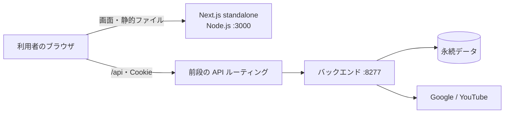

# NASB1995 フロントエンド 総合設計書

## 1. 文書の目的と対象

本書は、アジャイル開発で段階的に構築・変更されてきたシステムの現行実装を、要件定義・基本設計・詳細設計の観点でまとめたものである。2026年11月19日時点の本リポジトリ（nasb-next）のソース、テスト、設定ファイルおよび README を根拠とする。過去の意思決定、開発プロセスの実績、将来の計画を保証するものではない。以後の変更では、本書も実装と併せて更新する。

対象は Next.js によるフロントエンド、その画面から見た外部インターフェース、および本リポジトリで定義するビルド・配信構成とする。バックエンド、データベース、Google・YouTube 側の内部設計は対象外とし、API の完全な契約はバックエンド側で定める。

章立てと記述の粒度は `../nasb-vue/docs/DesignDocument.md` を参考にする。Vue 版とはホームの表示方式、画面遷移、状態管理などが異なるため、仕様は本プロジェクトの実装を正とする。参考先に記載された AWS の実配置や運用手順は、本リポジトリだけでは同一と確認できないため、そのまま転記しない。画面の配色・大きさ・部品の見た目の決まりは [UIGuidelines.md](UIGuidelines.md) にまとめる。

## 2. 要件定義

### 2.1 目的と利用者

賛美歌の曲名・歌詞・楽譜を閲覧、検索できるようにし、管理利用者が賛美歌、聖書の章節および本人の情報を管理できるようにする。また、YouTube と連携して賛美歌のプレイリストを作成できるようにする。

| 利用者                   | 主な利用                                                         |
| ------------------------ | ---------------------------------------------------------------- |
| 未ログインの閲覧者       | ホームで賛美歌を検索・閲覧し、楽譜を取得する                     |
| ログイン済みの管理利用者 | 賛美歌・楽譜・聖書の節・本人情報を管理し、YouTube 連携を利用する |

ホームは幅768pxを境に PC とモバイルの表示を切り替える。モバイルのホームにはログインボタンを置かないが、`/login` の直接表示や管理画面の利用を画面幅で拒否する処理はない。管理画面のサイドバーはモバイルではドロワーになる。画面側の認証確認は操作上の制御であり、権限の最終的な検証はバックエンドに依存する。

### 2.2 機能要件

| ID  | 要件           | 現行の実現方法                                                                                          |
| --- | -------------- | ------------------------------------------------------------------------------------------------------- |
| F01 | 賛美歌の閲覧   | PC は金彩の装飾写本風の見開きと紙をめくるページ送り、モバイルは横スワイプのカードと歌詞シートで閲覧する |
| F02 | 賛美歌の検索   | ホームでは入力に応じて画面内検索とサーバー検索を使い分ける。一致度を示し、歌詞の一致箇所を強調する      |
| F03 | 楽譜の取得     | 登録された調を選び、楽譜をダウンロードする。PC ホームでは選択中の調の五線譜を押して取得する             |
| F04 | 認証           | ログイン・ログアウトし、管理画面の表示前にログイン状態を確認する                                        |
| F05 | 賛美歌の管理   | 一覧の検索・ページ送り、モーダルでの追加・編集、削除可否の確認と削除を行う                              |
| F06 | 楽譜の登録     | ファイル、調、オリジナル指定を送信し、409 応答時は上書きを確認する                                      |
| F07 | ランダム選択   | キーワードによる5曲の選択を API に要求する。管理ヘッダーからの検索にも対応する                          |
| F08 | プレイリスト   | 一覧の検索条件またはランダム選択結果から YouTube プレイリストを作成し、進捗と結果を示す                 |
| F09 | 聖書の章節入力 | 書・章・節と英語・日本語本文を入力する。登録済みの節は読み込み、保存前に上書きを確認する                |
| F10 | 本人情報と連携 | ログイン中の本人の情報を更新し、YouTube 連携の開始・解除を行う                                          |
| F11 | 編集内容の保護 | 賛美歌の追加・編集と聖書章節入力で、対象操作による未保存内容の破棄を確認する                            |
| F12 | エラー通知     | 入力不備、通信失敗、セッション失効、操作結果等を通知し、描画エラーと404の画面を用意する                 |

聖書奉読・聖書章節選択、レシート明細入力、メッセージは未実装である。メニューを押すと未実装のトーストを出し、実画面には遷移しない。

### 2.3 非機能要件・実装上の方針

- **対応画面**: ホームの PC・モバイル切り替えと、管理サイドバーの折りたたみ・ドロワー表示を行う。管理一覧などの小さい画面での使いやすさは、画面幅によるアクセス可否とは別に確認する。
- **安全性**: Cookie を伴う通信、CSRF トークン、認証状態の確認を使用する。入力検証やクライアント側の表示制御だけでサーバー側の認証・認可を代替しない。
- **操作性**: 入力エラー、読み込み中、確認、失敗、完了を画面に示す。検索・ログインはフォーム送信とし、Enter による操作に対応する。白背景で `destructive` を使う危険操作では、ホバー・フォーカス時も通常サイズの文字と背景のコントラスト比を4.5:1以上とする。対象の状態と配色は [画面デザインの決まり](UIGuidelines.md) の3.1に記載する。未保存確認の適用範囲は4.7に記載する。
- **性能**: TanStack Query のキャッシュ、検索索引、ページ分割、モバイルの先読みを利用する。応答時間や同時利用者数の数値目標・測定結果は、本リポジトリでは定義していない。
- **保守性**: 画面、共通部品、通信、状態、業務ロジックを分け、型検査・静的解析・自動テストを用いる。依存バージョンは `package.json` と `pnpm-lock.yaml` を正とする。
- **対応ブラウザ**: 自動 E2E の対象は Chromium である。Chrome・Edge・Firefox・Safari 等の正式な最低対応バージョンと受入結果は別途定める。
- **配信**: Next.js の standalone 出力を Node.js サーバーとしてコンテナで配信する。静的エクスポートや nginx によるフロントエンドの静的配信ではない。

## 3. 基本設計

### 3.1 システム構成と責務

Next.js App Router がページと共通レイアウトを構成し、ブラウザ内の React が画面状態、入力検証、API 呼び出し、検索の一部を担当する。ルートのレイアウトと `/` のリダイレクト等はサーバー側の構成要素で、ホーム・ログイン・管理画面の操作は Client Component で実装する。バックエンド API を実装する Route Handler は本リポジトリにはない。

開発時だけ `next dev` が `/api` を除去して `http://localhost:8277` に転送する。本番は前段の nginx・CloudFront 等が `/api` をバックエンドへ直接振り分ける前提であり、この Next.js コンテナ自身には本番用の API 転送設定がない。図は論理構成であり、前段や DB の実配置を示すものではない。根拠は [next.config.ts](../next.config.ts) と [Dockerfile](../Dockerfile) とする。

### 3.2 画面と遷移

| パス                 | 画面                   | 利用条件・主な操作                                                          |
| -------------------- | ---------------------- | --------------------------------------------------------------------------- |
| `/`                  | 入口                   | サーバー側で `/home` へ転送                                                 |
| `/home`              | ホーム                 | 公開。検索、曲の選択、歌詞、楽譜取得、PC のログイン導線                     |
| `/login`             | ログイン               | ユーザー名・パスワードを送信し、成功後に `/mainmenu` へ移動                 |
| `/mainmenu`          | メインメニュー         | 認証。賛美歌一覧、ランダム選択等への入口                                    |
| `/hymns`             | 賛美歌情報メンテナンス | 認証。検索、追加・編集モーダル、削除、楽譜登録・取得、プレイリスト作成      |
| `/hymns/random-five` | 賛美歌ランダム選択     | 認証。検索・再選択、結果からのプレイリスト作成                              |
| `/books/add`         | 聖書章節入力           | 認証。書・章・節と英語・日本語本文の登録・更新                              |
| `/personal`          | ユーザー情報           | 認証。本人情報更新、YouTube 連携・解除                                      |
| `/error`             | エラー                 | 認証。`errMsg` を URI デコード・UTF-8 Base64 復号して表示。失敗時は既定文言 |
| その他               | 404                    | 存在しないパスの案内とホームへのリンク                                      |

`src/app/(admin)` は URL に含まれないルートグループであり、管理画面の認証確認と共通レイアウトを適用する。`src/app/error.tsx` は描画エラーを受け止める境界で、URL の `/error` 画面とは別のものである。

PC ホームは金彩の装飾写本をイメージした見開きとし、左の目次を1ページ10曲、右を選択曲の詳細とする。「前」「次」で紙をめくる。ページや検索が変わると先頭曲を選択し直し、目次内は上下キーでも移動できる。初期の調はオリジナルキーを優先し、なければ API が返した最初の調を使う。調の切り替えで五線譜の調号を変え、五線譜を押すと楽譜を取得する。

モバイルホームは横スワイプのカルーセルとし、サーバー検索では10曲ずつ取得する。取得済みカードの終わりから残り4枚以内に近づくと次のページを先読みする。スライドの総数は全件数で固定し、未取得のうち現在位置から前後4枚以内をスケルトン、それより遠い位置を空の箱にする。歌詞は下から出るシート、複数の調の選択は中央ダイアログで表示する。

### 3.3 データの概念

| データ           | 主な項目・用途                                                                                      |
| ---------------- | --------------------------------------------------------------------------------------------------- |
| 賛美歌一覧       | 文字列 `id`、`nameJp`、`nameKr`、`link`、一致度 `lineNumber`、任意の `snippet`                      |
| 賛美歌詳細       | 一覧とは別に、`lyric`、`classic`、`updatedTime`、`updatedUser` を編集に使用                         |
| 検索索引         | `version`、`hymns`。各曲の日本語名、韓国語名、英語名 `nameEn`、日本語・英語歌詞の `lines` 等        |
| 楽譜             | 賛美歌、調 `chord`、ファイル、オリジナル指定 `isOriginal`。曲と調を指定して取得                     |
| 聖書の節         | 書・章の ID と名称、節番号、`textEn`、`textJp`。既存節には表示名 `name` もある                      |
| 認証利用者       | 文字列 `id`、`username`、画面側で空配列に設定する `roles`                                           |
| 本人情報         | `loginAccount`、`username`、`password`、`dateOfBirth`、`email`                                      |
| CSRF             | `token`、`headerName`、`parameterName`。要求時にはヘッダーを使用                                    |
| プレイリスト処理 | `playlistId`、`playlistUrl`、状態 `state`、対象件数 `total`、追加済み件数 `added`、任意の `message` |

上記は画面・API 上の論理項目であり、物理テーブル定義ではない。賛美歌の19桁の Snowflake ID は JavaScript の数値精度を避けるため文字列で扱う。`snippet` は取得・生成するが、現行のホーム・管理一覧では表示しない。型の主な定義は [src/api/hymns.ts](../src/api/hymns.ts) と [src/lib/localSearch.ts](../src/lib/localSearch.ts) にある。

## 4. 詳細設計

### 4.1 構成要素

| 領域                             | 責務                                                                                                                        |
| -------------------------------- | --------------------------------------------------------------------------------------------------------------------------- |
| `src/app/layout.tsx`・`fonts.ts` | HTML の言語・タイトル・アイコン、全体の CSS・フォントと Provider の適用                                                     |
| `src/app/providers.tsx`          | QueryClientProvider、共通 TooltipProvider、FeedbackHost、起動時 CSRF 取得                                                   |
| `src/app` 配下の `page.tsx`      | 画面と画面単位の状態。`(admin)/layout.tsx` は認証確認・セッション確認・共通ナビゲーション                                   |
| `src/components`                 | 賛美歌フォーム、楽譜登録、歌詞、調の選択、赤字エディタ、通知等の共通部品                                                    |
| `src/components/home`            | PC ホームの見開き表示と、SVG で調号を描く五線譜                                                                             |
| `src/components/ui`              | shadcn/ui CLI が生成する Base UI + Nova の公式部品。Button、Dialog、Sidebar、Table、Carousel 等                             |
| `src/api`                        | Axios 共通設定、賛美歌 API の型・取得関数・クエリキー                                                                       |
| `src/stores`                     | Zustand による認証（auth）、CSRF（csrf）、通知・確認（feedback）、未保存状態（unsavedGuard）                                |
| `src/hooks`                      | ホームの画面幅判定、遅延反映、未保存確認、プレイリスト作成の共通処理。`use-mobile.ts` は公式 Sidebar に付属する生成ファイル |
| `src/lib`                        | 検索、歌詞照合、調号、ダウンロード、プレイリストのポーリング、入力検証、ページ番号等                                        |
| `src/app/globals.css`            | デザイントークン、ガラス表現、書体のクラス、赤字エディタ、見開きホーム                                                      |
| `public/assets`                  | 背景画像、メニュー用 SVG 等。固定パスで配信                                                                                 |
| `e2e`                            | API モックと Playwright による画面操作テスト                                                                                |

Next.js 16、React 19、TypeScript、Tailwind CSS v4、shadcn/ui（Base UI + Nova）、Zustand、TanStack React Query、Axios、Embla Carousel、Lucide を使用する。インストールされた版はロックファイルで固定する。

#### shadcn/ui 公式部品とアプリ固有の処理

shadcn/ui のスタイルは [components.json](../components.json) の `base-nova` で指定する。`src/components/ui` と `src/hooks/use-mobile.ts` は CLI の生成コードを使う。Dialog、Popover、Select、メニューなどの操作とフォーカス管理は Base UI が担い、既存要素との組み合わせには `render` を使う。ボタンの外観を持つリンクには `buttonVariants` を使い、リンクとしてのセマンティクスを保つ。

`src/app/globals.css` では `shadcn/tailwind.css` の共通ユーティリティを読み込み、アプリの配色を定義する。本人情報の YouTube 連携スイッチの寸法や「廃棄」ボタンの配色など、画面固有の指定はアプリ側の CSS や呼び出し側の `className` で行う。

ホームの画面幅は [use-mobile-viewport.ts](../src/hooks/use-mobile-viewport.ts) で `matchMedia` の変更を購読する。サーバー側とブラウザの初期描画では画面幅を未確定とし、確定後に PC・モバイルに応じた一覧を取得する。管理画面の Sidebar は公式の `use-mobile.ts` を使う。

### 4.2 認証・通信・セッション

1. `Providers` のマウント時に `/common/csrf` を非同期取得する。取得完了まで画面の描画を止める構成ではない。失敗はログへ出し、その後の更新要求が403になった場合の再取得に委ねる。
2. Axios は `/api` を基点とし、`withCredentials: true` と `Accept: application/json` を指定する。GET・HEAD・OPTIONS 以外には、取得済み CSRF トークンをサーバー指定のヘッダー名で付ける。
3. 403 応答時はトークンを再取得し、要求単位の `_csrfRetried` フラグで最大1回だけ再送する。再送後の403は呼び出し元に返す。CSRF 原因と権限拒否をこの段階では区別しない。
4. ログインは `URLSearchParams` による `username`・`password` の送信後、`/common/me` と CSRF トークンを再取得する。ログイン応答のメッセージは `localStorage` の `redirectMessage` に置き、移動後に1回表示する。送信中はボタンを無効化し、スピナーにする。最低待機時間は設けない。
5. 管理レイアウトは、認証確認が完了するまで子画面を描画しない。ストア上で未ログインなら `/common/me` を取得し、未認証または確認失敗なら `/home` へ置き換え遷移する。画面幅やロールによる追加ガードはない。
6. 管理画面の表示中は、タブが表示されている間、15秒ごとに `/common/me` を呼ぶ。非表示中は停止し、再表示時は直ちに確認する。一時的な通信失敗では確認処理を止めない。
7. 401 の `error: SESSION_INVALIDATED` は、別端末ログインによる失効として通知付きでホームへ全画面遷移する。ログイン中の通常の401も期限切れとして同様に扱う。ただし `/login` と `/common/me` の通常の401は共通処理から除外し、ログイン失敗・認証確認として個別に処理する。
8. 強制遷移は `hardRedirectHome()` で未保存警告を抑止し、全画面遷移により Zustand と Query のメモリ状態を初期化する。通知は `localStorage` から1回取り出す。
9. 通常のログアウトは、未保存内容の確認、ログアウト確認、`POST /logout`、本人状態の消去、CSRF 再取得、ホームへの全画面遷移の順で行う。ログアウトまたは CSRF 再取得の失敗を画面内で通知する処理はない（7章）。

`/common/me` の応答からは `id` と `username` だけを読み、`roles` は空配列にする。`hasRole()` は用意されているが、現在の画面はロールによる出し分けを行わない。認可条件はバックエンド側で定める。

根拠は [src/api/axios.ts](../src/api/axios.ts)、[src/stores/auth.ts](../src/stores/auth.ts)、[管理レイアウト](<../src/app/(admin)/layout.tsx>)、[src/lib/session.ts](../src/lib/session.ts) とする。

### 4.3 検索・歌詞・キャッシュ

- ホームで空文字、ハングルを含む語、先頭が `*`・`★`・`#` の語、または `&` を含む語はサーバー検索に送る。送信するキーワードは NFC に正規化する。管理一覧は入力言語によらずサーバー検索を使う。
- その他の日本語・英語等は `/hymns/search-index` を取得して画面内で照合する。日本語名・英語名と日本語・英語歌詞が対象で、韓国語歌詞は対象外とする。NFKC、英字小文字化、カタカナのひらがな化、記号・空白の除去を行う。
- 曲名の完全一致・前方一致・部分一致、歌詞の部分一致、文字2-gramの被覆率を採点する。あいまい一致の被覆率下限は0.7で、曲名には3文字以上の順序一致も使う。同点は索引の順序を維持する。
- ローカル採点は0.9超を `CADMIUM`、0.7以上を `BURGUNDY`、それ未満の正の点を `NAPLES`、非一致を `SNOWY` とする。一致曲を点の高い順に先に並べ、非一致曲も後方に残す。一致がない場合は通常順の全曲を表示して案内する。索引の取得に失敗した場合はサーバー検索へ戻す。

| `lineNumber`    | 表示     | PC ホームの記号 |
| --------------- | -------- | --------------- |
| `CADMIUM`       | よく一致 | ◆◆◆             |
| `BURGUNDY`      | 一致     | ◆◆◇             |
| `NAPLES`        | やや一致 | ◆◇◇             |
| `SNOWY`・その他 | 関連     | ◇◇◇             |

一致度は検索を確定した場合に表示する。PC ホームの目次には検索中も通し番号を残す。歌詞照合は検索語の先頭の絞り込み記号を外し、`&` で区切り、空白と重複を除く。本文は NFC・大文字小文字を区別しない一致で分割し、PC は臙脂の下線、モバイルは黄色の背景で強調して一致箇所数を示す。ローカル検索のあいまい照合とは別処理なので、検索結果に含まれていても本文中の一致箇所が0になる場合がある。

TanStack Query の既定値は `staleTime: 30秒`、取得失敗時の再試行は1回とする。主な例外は次のとおり。`staleTime` は取得済みデータを新しいとみなす期間であり、その時間ごとの自動ポーリングを意味しない。

| 対象               | 設定・扱い                                                                  |
| ------------------ | --------------------------------------------------------------------------- |
| 検索索引・歌詞     | 5分                                                                         |
| 楽譜の調の一覧     | 60秒。ホームと管理一覧でキャッシュを共有                                    |
| 編集用の賛美歌詳細 | 0。フォーカス復帰・再接続での再取得と再試行を無効化                         |
| 本人情報           | 0。フォーカス復帰・再接続での再取得を無効化                                 |
| 書・章の一覧       | `Infinity`。利用中は新しいデータとして扱う                                  |
| ランダム選択       | `staleTime: Infinity`、`gcTime: 0`、再試行なし。検索ごとの nonce で引き直す |
| 既存節の照会       | `gcTime: 0`。参照されなくなった結果は保持しない                             |

賛美歌の追加・編集・削除後は `hymns` で始まるクエリを無効化する。歌詞編集後はその曲の `lyric`、楽譜登録後はその曲の `score-keys` も無効化する。検索条件の切り替え等で `keepPreviousData` が働く場合は前回の行を残し、取得中は薄く表示する。PC ホームの「前」「次」では、移動先の一覧を先に用意する。

根拠は [src/lib/localSearch.ts](../src/lib/localSearch.ts)、[src/lib/lyrics.ts](../src/lib/lyrics.ts)、[src/lib/queryClient.ts](../src/lib/queryClient.ts)、[src/lib/scoreKeys.ts](../src/lib/scoreKeys.ts) とする。

#### PC ホームのページ送り

1. 「前」「次」が押されたら、画面内検索では索引から移動先の行を切り出せる状態とし、サーバー検索では TanStack Query の一覧キャッシュを確認して必要な場合だけ取得する。取得を待つ間は現在の見開きとページ番号を保ち、ページ送りの横に読み込みを表示する。
2. 一覧が用意できたら、演出用に現在の左右ページを複製し、移動先のページ番号と一覧に切り替える。先頭曲の歌詞・楽譜の調は新しい見開きで個別に読み込む。
3. 「次」は右から左、「前」は左から右へ、綴じ目を軸に紙の表裏と影を約620ms動かす。演出用の複製はフォーカス・読み上げ・操作の対象から外す。端末で動きを減らす設定が有効なら、演出を省いて一覧を切り替える。
4. 取得中・演出中に追加のページ送りを受け付けない。取得失敗を通知したら現在ページから再試行できる。検索・ロゴによるリセットや、PC 表示からの離脱があれば、待機中のページ送りを取り消し、その応答で後からページを動かさない。

ページ送りの制御は [OpenHymnalHome.tsx](../src/components/home/OpenHymnalHome.tsx)、演出の複製と終了処理は [BookPageTurn.tsx](../src/components/home/BookPageTurn.tsx) にある。

### 4.4 賛美歌・楽譜の管理

- 管理一覧は初期10件、5・10・15件を選択できる。検索・件数変更時は1ページ目に戻り、削除後に現在ページが総ページ数を超えた場合は最終ページへ戻る。行クリックまたは行上の Enter で YouTube を別タブに開き、操作列のイベントは行に伝えない。
- 追加・編集・楽譜登録はモーダルで開き、一覧の検索条件とページ位置を保持する。追加成功時は検索を解除し、応答ヘッダー `X-Page-Num` のページへ移動する。ヘッダーがなければ1ページ目とする。
- 賛美歌フォームは日本語名、韓国語名、リンク、歌詞を必須とし、クラシック区分を指定する。日本語名・韓国語名のフォーカス離脱時に重複確認 API を呼び、韓国語名は NFC に正規化する。保存時には必須チェックと保持中の重複エラーを確認する。重複確認中の保存待ちや古い応答の無効化は行わない（7章）。
- 編集時は取得した詳細に含まれる更新時刻 `updatedTime` と認証利用者の `updatedUser` を送信する。編集中の自動再取得を止め、取得済みの更新時刻を保持する。競合判定の完全な契約はバックエンド側で確認する。詳細取得失敗時は通知してモーダルを閉じる。
- 削除は `/delete-check` と利用者の確認後に行う。成功時は `X-Page-Num` があればその値、なければ「削除しました」を表示する。このヘッダーを削除通知にも使う妥当性は別途確認する。
- 楽譜登録はファイルと調を必須とし、30 MiB（`30 × 1024 × 1024` バイト）を超えるファイルは選択時に拒否する。選択欄の `accept` は PDF・JPG・JPEG・PNG・GIF とするが、内容の検証はサーバー側に依存する。
- 登録する調は A、Bb、B、C、Db、D、Eb、E、F、Gb、G、Ab の12長調。登録画面はこの順に6列2段とする。取得した調の一覧は API の返却順を保ち、フロントエンドでは並べ替えない。
- `score`、`chord`、`isOriginal`、`overwrite` を multipart で送り、タイムアウトを66秒とする。409 応答時は入力を保って上書きを確認し、「はい」で `overwrite=true` を再送する。「いいえ」・Esc は上書きせず登録モーダルに残る。
- 管理一覧とモバイルホームでは、調が複数なら選択 UI を開く。0件・1件なら調を省略して取得し、サーバー側の選択に委ねる。取得は Blob とし、保存名は調指定時に `{id}({chord}).pdf`、省略時に `{id}.pdf` とする。Blob URL はクリックから1秒後に解放する。

根拠は [管理一覧](<../src/app/(admin)/hymns/page.tsx>)、[HymnFormModal.tsx](../src/components/HymnFormModal.tsx)、[HymnScoreModal.tsx](../src/components/HymnScoreModal.tsx)、[src/lib/download.ts](../src/lib/download.ts) とする。

### 4.5 聖書の章節と本人情報

- 書を選ぶとその書の章一覧を取得し、章を未選択または一覧外とした場合は先頭章を使う。書の変更時は章の選択をリセットする。書は検索できるコンボボックス、章は数字のタイプアヘッドに対応する選択欄とする。
- 章が選ばれ、節が数字だけで構成されるとき、入力が300ms落ち着いてから既存節を照会する。取得結果の先頭を既存節とし、未編集ならその本文を表示する。照会待機・通信中は保存ボタンを無効化する。
- 既存節がある場合は「更新」、ない場合は「追加」とする。既存節または照会失敗の場合は上書きの可能性を確認して保存する。本文を編集済みなら照会結果で上書きせず、「既存の内容を読み込む」で読み直せるようにする。
- 保存時は英語本文、日本語本文、節番号の空欄を検証する。節の整数範囲や章の必須チェックを保存処理内で統一して検証する実装はないため、照会条件と保存条件の違いに留意する（7章）。保存成功後は節番号・編集本文・エラーをクリアし、書・章は保持する。
- 赤字は `{{...}}` と `contentEditable` 内の赤字 span を相互変換する。選択範囲の赤字化・解除、日本語変換中の処理抑止、カーソル位置の復元を行う。通常文字はテキストノード、赤字本文は `textContent` で組み立てる。
- 本人情報の編集対象 ID は URL ではなく認証状態から取得する。ログインアカウント、ユーザー名、パスワード、生年月日、メールアドレスを必須とし、アカウントはフォーカス離脱時に重複確認する。
- 本人情報の取得結果を基準に、利用者が入力した差分を重ねて表示する。「元に戻す」では差分を捨てて再取得し、更新成功時はキャッシュを無効化してメインメニューに戻る。パスワードの固定マスク値の扱いはバックエンドとの契約に依存する。
- YouTube のスイッチを ON にすると連携ボタンを有効にする。未連携なら連携ボタンから `/api/youtube/authorize-url` へ通常の画面遷移を行う。連携済みで OFF にすると解除を要求し、失敗時は ON に戻す。連携済みのボタンは無効化する。
- Google 同意画面からの戻りでは `youtube` クエリの `connected`・`error`・`invalid_state`・`unauthorized` に応じて通知し、`/personal` に置き換えてクエリを除去する。

根拠は [聖書章節入力](<../src/app/(admin)/books/add/page.tsx>)、[RedLetterEditor.tsx](../src/components/RedLetterEditor.tsx)、[本人情報](<../src/app/(admin)/personal/page.tsx>) とする。

### 4.6 プレイリスト

一覧からは確定済みの `keyword`、ランダム選択からは表示結果の `hymnIds` を送る。一覧のページをまたぐ対象曲の収集はバックエンドに委ねる。一覧側の想定対象は `BURGUNDY`・`CADMIUM` の曲で、ブラウザが全ページを取得して ID を収集する構成ではない。

`POST /youtube/create-playlist` の受付結果から状態を取り、`running` の間は1.5秒ごとに `/youtube/playlist-status` を呼んで `added/total` を表示する。受付後の待機時間が10分を超えると待機を終了して案内するが、サーバー側の作成を中止する要求は送らない。

`done` では YouTube へ移動するかを確認し、承諾時は返却された `playlistUrl` ではなく YouTube のプレイリスト一覧を別タブで開く。`failed` は `message`、なければ既定文言を表示する。開始要求の409では未連携または再認証として、本人情報画面への移動を確認する。

作成中の表示状態は `usePlaylistCreation()` を呼ぶ各画面のローカル状態とする。作成ボタンは処理中に無効化するが、画面をまたぐ共通ジョブストア、離脱時の確認、アンマウント時のポーリング停止、作成中止 API の呼び出しはない。離脱・再読み込み後の進捗復元も行わない。

根拠は [src/hooks/use-playlist-creation.ts](../src/hooks/use-playlist-creation.ts) と [src/lib/youtube.ts](../src/lib/youtube.ts) とする。

### 4.7 未保存確認・通知・エラー

| 対象                             | 未保存確認の範囲                                                                            |
| -------------------------------- | ------------------------------------------------------------------------------------------- |
| 賛美歌の追加・編集               | 基準値との差を検知し、モーダルの閉じる・×・背景クリック・Esc で破棄を確認。保存中は閉じない |
| 聖書章節入力                     | 本文の入力・既存本文との差を検知。書・章・節の選択値だけの変更は対象外                      |
| 管理レイアウトの移動             | `dirty` を見て、サイドバー等から別パスへ移動する前とログアウト前に確認                      |
| ブラウザからの離脱               | 対象フォームが未保存の間、タブを閉じる・再読み込み等に `beforeunload` の標準確認            |
| 本人情報・楽譜登録・プレイリスト | 共通の未保存確認を適用していない。楽譜はアップロード中にモーダルを閉じる操作のみ抑止        |

管理レイアウトの確認は専用の `go()` を経由する操作に適用する。App Router のすべての遷移やブラウザの戻る・進むを一律に止めるガードではない。同じパスへの移動はクエリの有無によらず確認を省く。強制ログアウトでは `bypass` により標準確認を抑止する。

トーストは Sonner を使い、画面下中央に3秒表示する。共通の確認は Promise で回答を返し、「いいえ」「はい」に統一する。タイトルは上書きに「上書きの確認」、ログアウト・削除に「警告」、それ以外に「お知らせ」を使う。Esc は否定として扱う。前の共通確認が未回答のまま次を開く場合は、前の確認を `false` で解決する。

エラー文言は `extractErrorMessage()` が文字列本文または `message` の文字列化を使い、該当しなければ画面ごとの既定文言を返す。空文字・空白・無効な `message` の共通検証はない。楽譜取得の Blob エラーは JSON を読み取り、プレーンテキストなら200文字以内で HTML の開始文字 `<` でないものだけを表示する。ホーム一覧の取得失敗は独自のトースト処理、管理一覧の取得失敗は専用表示がないため、扱いの統一は課題とする。

描画中の想定外の例外は `src/app/error.tsx` で案内し、`reset()` による再描画またはホームへの移動を用意する。404 は `src/app/not-found.tsx` で案内する。

### 4.8 API インターフェース一覧

パスは `/api` を除いたフロントエンド上の指定。下表は画面が使用する範囲であり、認可条件、全応答形式、エラーコードの完全な定義はバックエンド側で定める。

| メソッド・パス                                               | 用途・主な指定／応答                                                   |
| ------------------------------------------------------------ | ---------------------------------------------------------------------- |
| GET `/common/csrf`                                           | `token`・`headerName`・`parameterName` の取得                          |
| GET `/common/me`                                             | 認証確認。`id`・`username` を取得                                      |
| POST `/login`、`/logout`                                     | ログイン（`username`・`password` のフォーム送信）、ログアウト          |
| GET `/hymns`                                                 | `pageNum`・`pageSize`・`keyword`。`records`・`totalRecords` を取得     |
| GET `/hymns/search-index`                                    | 画面内検索索引の `version`・`hymns` を取得                             |
| GET `/hymns/{id}`、`/hymns/{id}/lyric`                       | 編集用詳細、`id`・`lyric` の取得                                       |
| POST `/hymns`                                                | `pageSize` と賛美歌情報を送信。追加先の `X-Page-Num` を参照            |
| PUT・DELETE `/hymns/{id}`                                    | 更新（`id`・`updatedTime` 等）・削除                                   |
| GET `/hymns/duplicate-check-jp`・`/hymns/duplicate-check-kr` | `id` と `nameJp` または `nameKr` による名称重複確認                    |
| GET `/hymns/{id}/delete-check`                               | 削除可否の事前確認                                                     |
| GET `/hymns/{id}/score`                                      | `keysOnly=true` で調一覧。それ以外は任意の `chord` で Blob 取得        |
| POST `/hymns/{id}/score`                                     | `score`・`chord`・`isOriginal`・`overwrite` を multipart 送信          |
| GET `/hymns/random`・`/common/search`                        | `keyword` によるランダム選択。前者は画面内、後者は管理ヘッダーから使用 |
| GET `/books`・`/books/{bookId}/chapters`                     | 書・章の `id`・`name` を取得                                           |
| GET `/books/{chapterId}/verse`                               | `verseNo` による既存節の配列を取得し、先頭を使用                       |
| POST `/books`                                                | `chapterId`・節番号 `id`・`textEn`・`textJp` の保存                    |
| GET・PUT `/students/{id}`                                    | 本人情報の取得・更新                                                   |
| GET `/students/duplicate-check`                              | `id`・`loginAccount` による重複確認                                    |
| GET `/youtube/status`・`/youtube/authorize-url`              | `linked` の取得、ブラウザ遷移による認可開始                            |
| POST `/youtube/unlink`                                       | YouTube 連携解除                                                       |
| POST `/youtube/create-playlist`                              | `keyword` または `hymnIds` で作成開始。`PlaylistStatus` を受け取る     |
| GET `/youtube/playlist-status`                               | `playlistId` で `running`・`done`・`failed` と件数等を取得             |

## 5. テスト・ビルド・運用

### 5.1 コマンドと自動検証

| コマンド                                | 目的                                                                  |
| --------------------------------------- | --------------------------------------------------------------------- |
| `pnpm install`                          | 依存関係の導入。pnpm の版は `package.json` の `packageManager` に従う |
| `pnpm install --frozen-lockfile`        | CI・Docker と同じ、ロックファイルを変更しない導入                     |
| `pnpm dev`                              | ポート3000の開発サーバー。開発時の API 転送を有効化                   |
| `pnpm lint`                             | ESLint による静的解析                                                 |
| `pnpm typecheck`                        | `tsc --noEmit` による型検査                                           |
| `pnpm test`・`pnpm test:watch`          | Jest の一括実行・監視実行                                             |
| `pnpm build`                            | Next.js の本番向けビルドと standalone 出力の生成                      |
| `pnpm start`                            | ビルド済みアプリを `next start` で起動。コンテナの起動方法は6.1に記載 |
| `pnpm exec playwright install chromium` | ローカル E2E 用のブラウザの導入                                       |
| `pnpm e2e`                              | Playwright による Chromium の画面操作テスト                           |
| `docker build .`                        | Node.js による配信イメージの作成                                      |

[ESLint の設定](../eslint.config.mjs) では、公式部品をそのまま管理するため、`use-mobile.ts` と `carousel.tsx` の `react-hooks/set-state-in-effect`、`sidebar.tsx` の `react-hooks/purity` にファイル単位の例外を設ける。前者は Effect 内の初期値の設定、後者は読み込み表示の幅を決める乱数が対象となった箇所である。アプリ側には両方のルールを適用する。公式部品を再生成したときは、差分と例外の要否を確認してから Lint・型検査・E2E を実行する。

ユニットテストは [jest.config.mjs](../jest.config.mjs) の `next/jest` 設定で `src/**/*.test.ts` を実行する。既定は Node 環境とし、DOM が必要なファイルでは `@jest-environment jsdom` を指定する。検索の振り分けと順位、歌詞照合、調号、ページ番号、名称サイズ、必須チェック、Base64、Blob 保存・エラー、CSRF 再送・401、プレイリスト進捗・タイムアウト等を確認する。

E2E は [e2e/mock-api.ts](../e2e/mock-api.ts) が `/api/**` の応答を差し替え、実バックエンドを起動しない。ホームでは767pxと768pxでの表示切り替え、モバイルのカルーセル操作、PC の前後のページ送り、取得待ち・失敗時の表示、動きを減らす設定の適用を確認する。管理画面ではログイン、未認証時の遷移、一覧のページ送り・表示件数変更・削除、調を選んでの楽譜ダウンロード、編集モーダル、破棄・ログアウト確認、ランダム選択、検索条件によるプレイリスト要求等を確認する。ログアウト確認は上部バーとサイドバーの両方から検証する。モバイルでのスワイプ操作全般、聖書章節の保存、実際の OAuth・YouTube 接続は網羅していない。

ローカルの `pnpm e2e` はビルド後、`.next/standalone` に `public` と `.next/static` を配置し、ポート3100で `server.js` を起動する。同じ URL の既存サーバーがあれば再利用する。CI は先にビルドするため、E2E 側ではサーバー起動だけを行う。

### 5.2 CI と確認範囲

[.github/workflows/ci.yml](../.github/workflows/ci.yml) は `main` への push とプルリクエストで、Node.js 22 と指定版の pnpm を使い、依存導入、Lint、型検査、ユニットテスト、ビルド、Chromium 導入、E2E の順に実行する。同じブランチの古い実行を中止し、失敗時は Playwright のレポートと結果を7日間保存する。

このワークフローに本番デプロイは含まれない。API をモックするテストは、実バックエンド・DB・Google・YouTube との結合を保証しない。性能・セキュリティ・アクセシビリティ・ブラウザ互換性の受入基準と実施結果は別途管理する。本章は既存の検証構成を説明し、設計書作成時にすべての試験に合格したと表明するものではない。

## 6. インフラ・配信構成

### 6.1 フロントエンドコンテナ

[Dockerfile](../Dockerfile) はビルド用・実行用の2段階とし、どちらも `node:22-alpine` を使う。ビルド段階で指定版の pnpm を導入し、キャッシュした pnpm ストアと `--frozen-lockfile` を使って依存を導入し、`pnpm build` を実行する。

実行段階には `public`、`.next/standalone`、`.next/static` をコピーし、`node` ユーザーで `node server.js` を実行する。環境変数は `NODE_ENV=production`、`PORT=3000`、`HOSTNAME=0.0.0.0` とする。Next.js がキャッシュを書き込めるよう、配置ファイルの所有者も `node` にする。

ヘルスチェックは30秒間隔、5秒タイムアウト、起動猶予15秒、失敗3回で、`http://127.0.0.1:3000/home` の応答を確認する。ホームの API データ取得はブラウザ側のため、これはフロントエンドの HTTP 応答の確認であり、バックエンドや DB の正常性は確認しない。

### 6.2 ルーティング・アセット

- 本番の前段は、フロントエンドへの要求を3000番へ、`/api` の要求を適切にパス変換してバックエンドへ送る必要がある。前段の設定や docker compose 定義は本リポジトリにはない。
- 楽譜の30 MiBはファイル単体の上限で、multipart の付加分を含まない。前段の要求サイズ上限とバックエンドの設定は、その付加分も通せる値で整合させる必要がある。画面の66秒のタイムアウトだけでは前段のタイムアウトを変更できない。
- 画像最適化は `images.unoptimized: true` とし、背景やメニュー画像は `public/assets` の固定 URL を使う。内容ハッシュ付き URL への自動変換はない。CDN 等でキャッシュする場合、画像差し替え時のキャッシュ設定・無効化方法は配信側で確認する。
- 日本語・韓国語フォントは Fontsource パッケージ、ロゴは `next/font/local` で自前配信する。ビルド時に Google Fonts から取得しない。

### 6.3 本リポジトリから確定できない運用情報

参考先の Vue 版設計書には AWS の配置と運用があるが、本プロジェクトへの適用を確認できる資料・構成ファイルは含まれない。次は本プロジェクトの確定仕様とはせず、運用側の資料で管理する。

| 項目             | 確認する内容                                                             |
| ---------------- | ------------------------------------------------------------------------ |
| DNS・TLS・CDN    | Route 53・ACM・CloudFront 等の利用、HTTPS 終端、オリジン通信、キャッシュ |
| 実行基盤         | サーバー種別、OS・CPU アーキテクチャ、コンテナ配置、イメージ保管先       |
| ネットワーク・DB | VPC・サブネット・セキュリティグループ、DB 製品と接続経路                 |
| デプロイ         | Jenkins 等の利用、取得するイメージタグ、停止時間、ロールバック手順       |
| 運用・秘密情報   | 監視・ログ・アラート、バックアップ・復旧、資格情報の保管・更新           |

アカウント ID、インスタンス ID、秘密情報などの識別子・認証情報は本書に記載しない。

## 7. 既知の課題・確認事項

現行実装から確認できる制約を記載する。以下は改善済みの仕様や実施予定を意味しない。

1. **一覧取得失敗の表示**: 管理一覧は取得エラーを専用表示せず、初回失敗を0件として表示し得る。再取得失敗時は古い行が残っても、その旨を示さない。ホームも取得失敗と0件の表示が重なる場合がある。
2. **重複確認の競合**: 賛美歌名とログインアカウントの確認はフォーカス離脱時に独立して行う。現在値の検査完了待ち・古い応答の無効化・通信失敗と重複の区別がなく、保存時の整合性はバックエンドに依存する。
3. **章節の検証**: 既存節の照会は数字だけを条件にする一方、保存は空欄検証が中心である。章未確定、数字以外、0、範囲外の節番号等の扱いを照会・保存で揃える必要がある。
4. **未保存保護の範囲**: 本人情報・楽譜の選択内容は未保存確認の対象外である。賛美歌・聖書本文も、専用の遷移処理を通らない移動やブラウザの戻る・進むには共通確認を適用しない。
5. **プレイリストの離脱**: 作成状態の画面間共有、中止要求、離脱後のポーリング停止・進捗復元がない。画面を開き直した場合の重複作成を含め、バックエンド側の契約と合わせて扱いを定める必要がある。
6. **ログアウト失敗時の扱い**: ログアウト成功後の CSRF 再取得に失敗すると、本人状態は消えても全画面遷移に到達しない。ログアウト要求そのものの失敗も共通の画面内通知で捕捉していない。
7. **エラー文言・削除応答**: 空文字・空白・無効な `message` で既定文言にならない場合がある。削除成功通知で参照する `X-Page-Num` が適切かも、追加時のページ番号の契約と分けて確認する。
8. **配信と検証の前提**: 固定名画像の本番キャッシュ、前段の API 転送・アップロード上限、運用基盤の実配置は本リポジトリでは確認できない。自動テストで未網羅のホーム・章節・外部連携や正式な対応ブラウザも、別途検証を要する。
